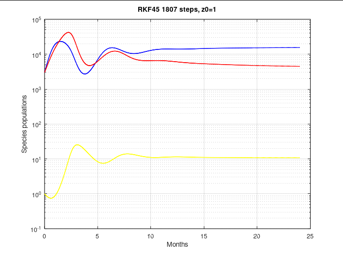

# Modeling Competing Species in the Presence of a Predator

Grant Lillehei & Addison McCarl, MAT455, Augsburg University

**[Read the paper (PDF)](main.pdf)**

Code: https://gitlab.com/lilleheg/competing-species/
